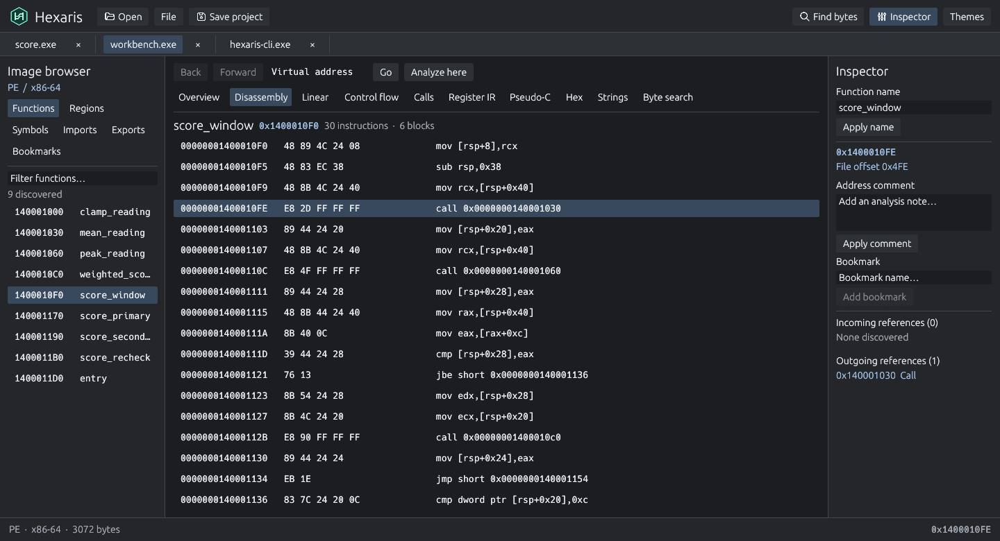
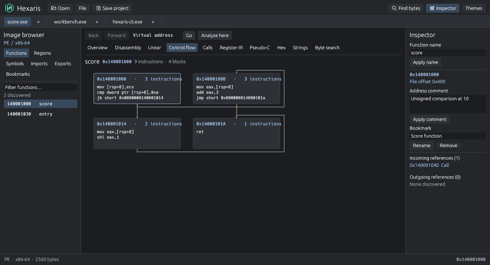
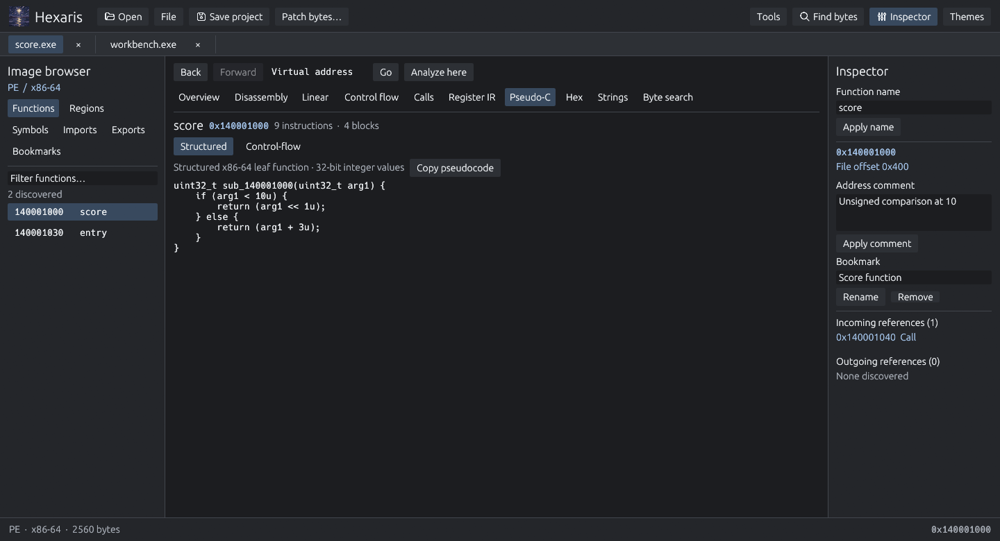
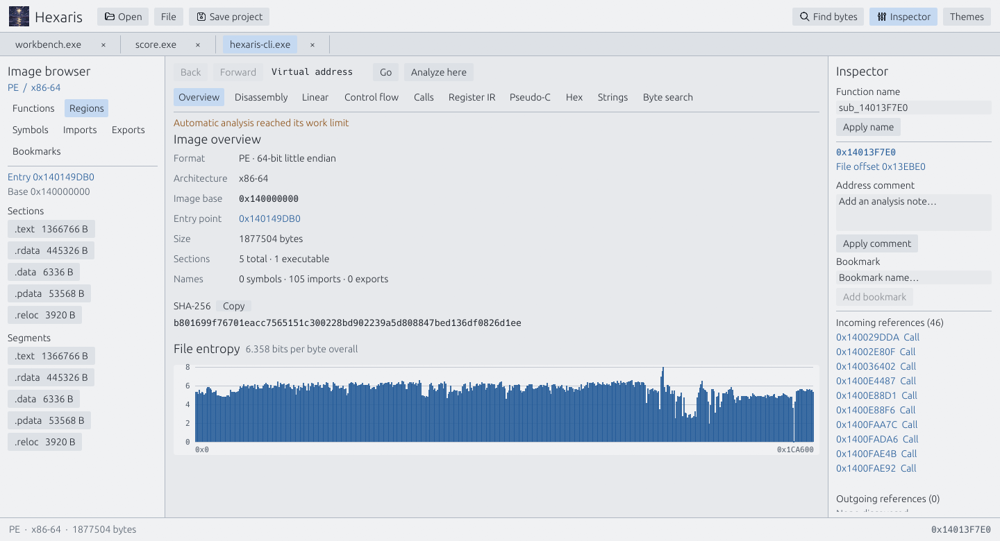
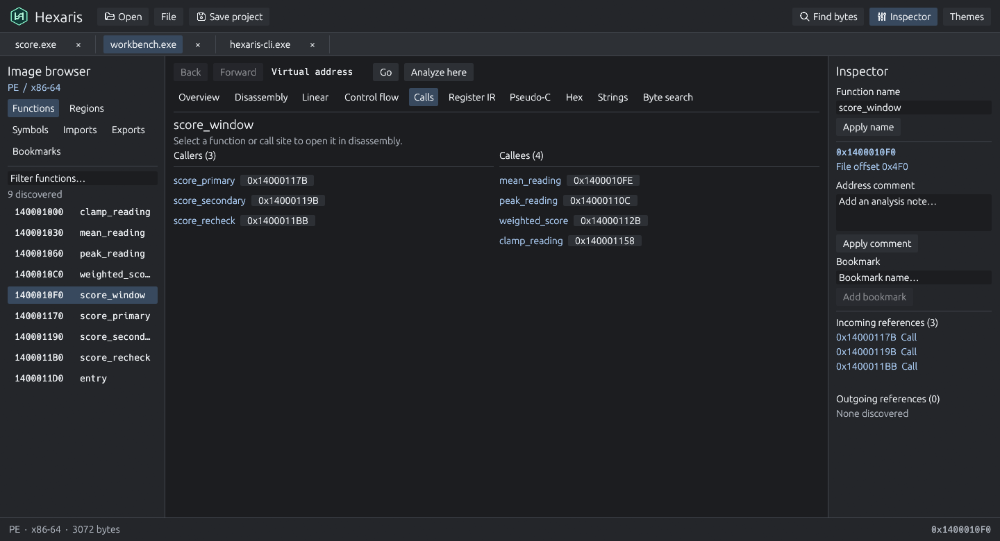
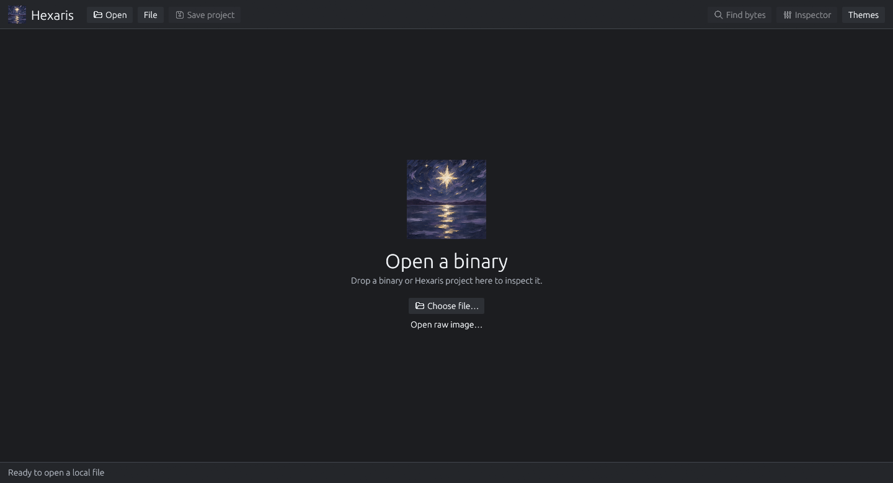

<p align="center">
  
  <br>
  <sub>Thomas Wijck, <em>The Alchemist</em> (detail), c. 1660–1670. Dupper Wzn. Bequest, Dordrecht. Public domain. <a href="https://id.rijksmuseum.nl/20026963">Rijksmuseum, SK-A-489</a></sub>
</p>

<h1 align="center">Hexaris</h1>

<p align="center">
  <strong>A native Rust workbench for inspecting executables.</strong><br>
  Follow machine code, browse binary metadata, and save your findings in a portable project.<br>
  Run the same analysis from the desktop or the command line.
</p>

<p align="center">
  <a href="https://github.com/Prestondevs/hexaris/releases/latest"><strong>Download for Windows x64</strong></a> ·
  <a href="#run-on-windows">Run on Windows</a> ·
  <a href="docs/USER_GUIDE.md">User guide</a> ·
  <a href="#features">Features</a> ·
  <a href="#command-line">Command line</a> ·
  <a href="#build-from-source">Build from source</a> ·
  <a href="LICENSE">MIT license</a>
</p>

<p align="center">
  
  <br>
  <sub>The Graphite workbench on a sample executable, with its function list and address inspector open.</sub>
</p>

## Features

<table>
  <tr>
    <td width="50%" valign="top">
      <a href="docs/images/control-flow.png"></a>
      <h3>Follow control flow</h3>
      Fit the selected function’s full control-flow graph or focus on a block. Follow edges and string references, search in place, and carry highlights between code views.
    </td>
    <td width="50%" valign="top">
      <a href="docs/images/pseudo-c.png"></a>
      <h3>Read lifted code</h3>
      Inspect 32-bit register SSA and incoming values at block boundaries. Pseudo-C shows structured expressions where supported and a register-level listing with branches, loops, and calls for other decoded functions.
    </td>
  </tr>
  <tr>
    <td width="50%" valign="top">
      <a href="docs/images/triage.png"></a>
      <h3>Inspect the file</h3>
      Find sections, symbols, imports and exports. Check the file’s SHA-256 or click the entropy chart to open the corresponding byte offset in Hex.
    </td>
    <td width="50%" valign="top">
      <a href="docs/images/calls.png"></a>
      <h3>Trace calls and references</h3>
      Browse direct callers and callees, jump to a call site, and check the inspector for incoming and outgoing references to the selected address.
    </td>
  </tr>
</table>

Screenshots show Hexaris analyzing its own CLI and the [score fixture](tests/fixtures/score.c) and [workbench fixture](tests/fixtures/workbench.c).

The [user guide](docs/USER_GUIDE.md) walks through the desktop views, CLI commands, and current source workflows for assistant context, annotation review, local MCP, and build comparison.

| Workflow | What Hexaris provides |
| --- | --- |
| Load an image | Inspect PE, ELF, thin Mach-O, and COFF metadata. Set an architecture and base address when opening raw x86 bytes. |
| Search and navigate | Search the current code view, printable strings, or wildcard byte patterns. Each tab keeps its own preferred view, selection, and history. |
| Save an investigation | Add comments, rename functions, and save bookmarks. A `.hxproj` embeds the binary and its annotations. [Project format](docs/PROJECT_FORMAT.md) |
| Move annotations between tools | Merge function names, comments, and bookmarks from Ghidra program XML. Existing Hexaris annotations keep their values. [Import guide](docs/GHIDRA_XML.md) |
| Export a patch | Right-click a supported branch to invert it, always take it, or always fall through. Queue fixed-length byte edits and open the exported copy for reanalysis. |
| Change the appearance | Preview and switch among Graphite, Slate, Ash Light, Foundry, and High Contrast in **Themes**. The selected palette is saved locally. |

## Run on Windows

1. Open the [latest GitHub release](https://github.com/Prestondevs/hexaris/releases/latest). Under **Assets**, download the file ending in `-windows-x64.zip`.
2. Right-click the downloaded ZIP, choose **Extract All**, and open the extracted folder.
3. Double-click **`hexaris.exe`**. Click **Choose file…** or drag an executable into the window to start analyzing it.

You can also open PowerShell in the extracted folder and launch the app there. Pass a file path to open it immediately, or run the included CLI for terminal workflows.

```powershell
.\hexaris.exe
.\hexaris.exe "C:\path\to\sample.exe"
.\hexaris-cli.exe --help
```

Use **File → Open raw image** for unstructured bytes. Press **Ctrl+D** to toggle a bookmark and **Ctrl+S** to save the current project. The release also provides a `.sha256` file for checking the ZIP download.

<p align="center">
  
</p>

Windows x64 is the validated release platform. The source also targets Linux and macOS. See the [feature matrix](docs/FEATURE_MATRIX.md) for tested coverage, including the current limits of decompilation and architecture support.

## Command line

The CLI runs offline and returns JSON for inspection and analysis commands. These PowerShell examples use the executable from the Windows ZIP.

```powershell
.\hexaris-cli.exe inspect sample.exe
.\hexaris-cli.exe triage sample.exe other.exe
.\hexaris-cli.exe analyze sample.exe
.\hexaris-cli.exe find sample.exe "48 8B ?? ??"
.\hexaris-cli.exe project create sample.exe sample.hxproj
```

Address-based commands accept decimal or `0x`-prefixed hexadecimal addresses. Run `hexaris-cli --help` to see the full command list.

## Build from source

Install the Rust toolchain from `rust-toolchain.toml` and the platform linker. Windows builds use MSVC and a Windows SDK. On Linux, the desktop uses system OpenGL, X11 or Wayland, and an XDG desktop portal for file dialogs.

```sh
cargo build --workspace --release --locked
cargo run --locked -p hexaris-desktop -- path/to/program
cargo test --workspace --locked
```

Run `scripts/package-windows.ps1` in a Windows developer shell to build the portable ZIP locally. The desktop and CLI use the same Rust engine. [Architecture](docs/ARCHITECTURE.md) · [Development environment](docs/DEVELOPMENT_ENVIRONMENT.md)

## Contributing

See the [contributor guide](CONTRIBUTING.md) for build checks and fixture instructions. Hexaris is distributed under the [MIT license](LICENSE). [Third-party notices](THIRD_PARTY_NOTICES.md)
